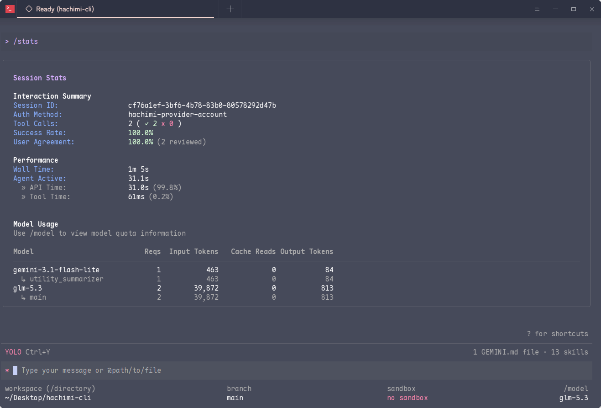

<!-- Improved compatibility of back to top link: See: https://github.com/othneildrew/Best-README-Template/pull/73 -->
<a id="readme-top"></a>
<!--
*** Thanks for checking out the Best-README-Template. If you have a suggestion
*** that would make this better, please fork the repo and create a pull request
*** or simply open an issue with the tag "enhancement".
*** Don't forget to give the project a star!
*** Thanks again! Now go create something AMAZING! :D
-->


<!-- PROJECT SHIELDS -->
<!--
*** I'm using markdown "reference style" links for readability.
*** Reference links are enclosed in brackets [ ] instead of parentheses ( ).
*** See the bottom of this document for the declaration of the reference variables
*** for contributors-url, forks-url, etc. This is an optional, concise syntax you may use.
*** https://www.markdownguide.org/basic-syntax/#reference-style-links
-->
[![Contributors][contributors-shield]][contributors-url]
[![Forks][forks-shield]][forks-url]
[![Stargazers][stars-shield]][stars-url]
[![Issues][issues-shield]][issues-url]
[![project_license][license-shield]][license-url]

> **注意**：本项目并非 Google 官方 Gemini CLI 项目，而是其衍生分支。我们与 Google **没有任何关联**。


<!-- PROJECT LOGO -->
<br />
<!--
<div align="center">
  <a href="https://github.com/CharOfString/hachimi">
    
  </a>
-->

<h3 align="center">哈基米</h3>

  <p align="center">
    Google Gemini CLI 的衍生分支，增强了审批模式并支持第三方模型。
    <br />
    <a href="./docs/"><strong>浏览文档 »</strong></a>
    <br />
    <br />
    <a href="https://github.com/CharOfString/hachimi/actions">查看 CI 状态</a>
    &middot;
    <a href="https://github.com/CharOfString/hachimi/issues/new">报告 Bug</a>
    &middot;
    <a href="https://github.com/CharOfString/hachimi/issues/new">请求功能</a>
  </p>
</div>


<!-- ABOUT THE PROJECT -->
## 关于本项目


*Hachimi* 是 Google *Gemini CLI* 的衍生分支，包含以下修改：
- 新增了第三方账户系统，支持自定义端点和提供商（移植自 [qwen-code](https://github.com/qwenLM/qwen-code)）。
- 新增了四级审批控制：manual、accept-edit、planning、YOLO（移植自 [qwen-code](https://github.com/qwenLM/qwen-code)）。
- 在需要审批时发送系统通知。
- 支持自定义 Logo：可使用 ASCII 艺术字，或在终端支持 Kitty 图形协议时使用 PNG 图片。
- 支持设置全局输出语言。


### 技术栈
- **运行时**：Node.js（≥20.0.0，开发环境推荐 ~20.19.0）。
- **语言**：TypeScript。
- **UI**：React + [Ink](https://github.com/vadimdemedes/ink)（终端渲染）。
- **打包工具**：esbuild。
- **测试**：Vitest（单元测试 + 集成/E2E 测试）。
- **代码检查/格式化**：ESLint、Prettier。


<!-- GETTING STARTED -->
## 快速开始
### 快速启动
```bash
$ npm run start
```

### 安装
```bash
$ npm run build:install
```

安装完成后，即可在终端中运行 `hachimi`。

<!-- USAGE EXAMPLES -->
## 用法
### 基本用法
#### 在当前目录启动
```bash
$ hachimi
```

#### 包含多个目录
```bash
$ hachimi --include-directories ../lib,../docs
```

#### 使用指定模型
```bash
$ hachimi -m gemini-2.5-flash
```

#### 非交互式模式（用于脚本）
获取简单文本响应：
```bash
$ hachimi -p "解释这个代码库的架构"
```

更高级的脚本用法，包括 JSON 解析和错误处理，可使用 `--output-format json` 参数获取结构化输出：
```bash
$ hachimi -p "解释这个代码库的架构" --output-format json
```

实时事件流（适用于监控长时间运行的操作），使用 `--output-format stream-json` 参数获取以换行符分隔的 JSON 事件：
```bash
$ hachimi -p "运行测试并部署" --output-format stream-json
```

### 功能特性
#### 切换审批模式
使用 `Shift` + `Tab` 在四种模式之间切换：manual、accepts-edits on、planning、YOLO。注意 YOLO 模式会授予"完全访问权限"。

审批模式的逻辑也进行了修改：原版 Gemini CLI 将 `package.json` 和 `CMakeLists.txt` 视为敏感文件，但我们已移除了这一设定。如需恢复原版 Gemini CLI 的行为，请在 hachimi 中运行：
```
> /approve mode default
```

恢复为 Hachimi 行为：
```
> /approve mode hachimi
```

#### 添加第三方账户提供商
要添加第三方账户提供商，请在 hachimi 中运行：
```
> /auth signin
```

然后选择 *provider accounts*。

可用提供商：
1. Alibaba ModelStudio · Coding Plan
2. Alibaba ModelStudio · Standard API Key
3. Alibaba ModelStudio · Token Plan
4. DeepSeek API Key
5. Grok (xAI) API Key
6. Idealab API Key
7. MiniMax API Key
8. ModelScope API Key
9. Kimi (Moonshot AI) API Key
10. OpenRouter
11. QwenCloud · Standard API Key
12. QwenCloud · Token Plan
13. Requesty
14. Z.AI API Key
15. 自定义提供商（OpenAI / Anthropic / Gemini）

#### 通知
默认情况下，hachimi 在需要审批时会发送系统通知，使用以下命令开关：
```
> /notification on
> /notification off
```

#### 自定义 Logo
你可以添加自定义 Logo。

隐藏 Logo：
```
> /logo off
```

添加 ASCII 艺术字 Logo（需要 UTF-8 文本文件）：
```
> /logo ascii <文件路径>
```

如果你的终端支持 Kitty 图形协议，甚至可以使用 PNG 图片：
```
> /logo kitty <图片.png>
```

#### 固定 Logo 和版本信息到顶部（需重启）
这是一个"彩蛋"功能，没有实际用途——只是将 Logo 和版本信息显示在终端顶部供你欣赏（但会占用终端的垂直空间）。

使用以下命令开关（需要重启）：
```
> /showver on
> /showver off
```

#### 设置全局语言
> **注意**：考虑到部分 TTY 无法渲染所有语言，TTY 下的语言输出被强制设为英语。

你可以创建 `~/.gemini/LANGUAGE_PREFERENCE.md` 并在其中写入提示语，例如：

```
Please response in ZH_CN while keeping all comments in English
```

<!-- ROADMAP -->
## 路线图
即将推出！


<!-- CONTRIBUTING -->
## 贡献
### 主要贡献者：

<a href="https://github.com/CharOfString/hachimi/graphs/contributors">
  
</a>


<!-- LICENSE -->
## 许可证
本项目基于 [Apache License Version 2.0](./LICENSE) 许可证发布。许可证文件可在项目仓库中找到。


<!-- CONTACT -->
## 联系方式
请通过 Issue 区与我联系。


<!-- ACKNOWLEDGMENTS -->
## 致谢
- **Gemini CLI**：https://github.com/google-gemini/gemini-cli
- **BEST README Template**：https://github.com/othneildrew/Best-README-Template


<!-- MARKDOWN LINKS & IMAGES -->
<!-- https://www.markdownguide.org/basic-syntax/#reference-style-links -->
[contributors-shield]: https://img.shields.io/github/contributors/CharOfString/hachimi.svg?style=plastic
[contributors-url]: https://github.com/CharOfString/hachimi/graphs/contributors
[forks-shield]: https://img.shields.io/github/forks/CharOfString/hachimi.svg?style=plastic
[forks-url]: https://github.com/CharOfString/hachimi/network/members
[stars-shield]: https://img.shields.io/github/stars/CharOfString/hachimi.svg?style=plastic
[stars-url]: https://github.com/CharOfString/hachimi/stargazers
[issues-shield]: https://img.shields.io/github/issues/CharOfString/hachimi.svg?style=plastic
[issues-url]: https://github.com/CharOfString/hachimi/issues
[license-shield]: https://img.shields.io/github/license/CharOfString/hachimi.svg?style=plastic
[license-url]: https://github.com/CharOfString/hachimi/blob/master/LICENSE.txt
[linkedin-shield]: https://img.shields.io/badge/-LinkedIn-black.svg?style=plastic&logo=linkedin&colorB=555
[linkedin-url]: https://linkedin.com/in/linkedin_username
[product-screenshot]: images/screenshot.png
<!-- Shields.io badges. You can a comprehensive list with many more badges at: https://github.com/inttter/md-badges -->
[Next.js]: https://img.shields.io/badge/next.js-000000?style=plastic&logo=nextdotjs&logoColor=white
[Next-url]: https://nextjs.org/
[React.js]: https://img.shields.io/badge/React-20232A?style=plastic&logo=react&logoColor=61DAFB
[React-url]: https://reactjs.org/
[Vue.js]: https://img.shields.io/badge/Vue.js-35495E?style=plastic&logo=vuedotjs&logoColor=4FC08D
[Vue-url]: https://vuejs.org/
[Angular.io]: https://img.shields.io/badge/Angular-DD0031?style=plastic&logo=angular&logoColor=white
[Angular-url]: https://angular.io/
[Svelte.dev]: https://img.shields.io/badge/Svelte-4A4A55?style=plastic&logo=svelte&logoColor=FF3E00
[Svelte-url]: https://svelte.dev/
[Laravel.com]: https://img.shields.io/badge/Laravel-FF2D20?style=plastic&logo=laravel&logoColor=white
[Laravel-url]: https://laravel.com
[Bootstrap.com]: https://img.shields.io/badge/Bootstrap-563D7C?style=plastic&logo=bootstrap&logoColor=white
[Bootstrap-url]: https://getbootstrap.com
[JQuery.com]: https://img.shields.io/badge/jQuery-0769AD?style=plastic&logo=jquery&logoColor=white
[JQuery-url]: https://jquery.com